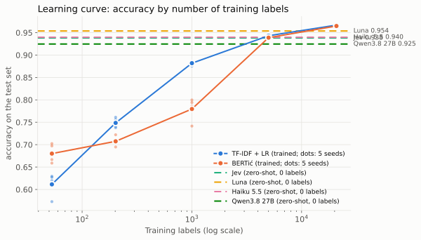

# Classification without fine-tuning

Can a model that was never trained on your data sort products into categories as well as a
model trained on 20,000 labeled examples? This repo compares six approaches on ~30,000 Croatian
retail product names and 10 categories, with the same input and the same test items, for
quality, speed and cost.

Companion repo for the talk "Classification without fine-tuning: Jev vs. BERT vs. LLMs".

## Results

Main test set: 5,938 products that the trained models never saw.

| Approach | Trained on our labels? | Accuracy | Macro-F1 | Latency (median) | Cost per 1,000 items |
|---|---|---|---|---|---|
| TF-IDF + logistic regression | yes (20,777) | 96.7% | 0.916 | 0.3 ms (CPU) | ≈ $0 |
| BERTić, fine-tuned | yes (20,777) | 96.5% | 0.913 | 3.0 ms (GPU) | ≈ $0 |
| OpenAI Decisions (GPT-6 Luna) | no | 95.4% | 0.883 | 246 ms | $0.040 |
| Claude Haiku 5.5 | no | 94.0% | 0.860 | 1,065 ms | $0.098 |
| Jev (TypeSafe) | no | 93.8% | 0.845 | 166 ms | $0.029 |
| Qwen3.8 27B | no | 92.5% | 0.829 | 700 ms | $0.042 |

- **With enough labels, the simple baseline wins.** TF-IDF and BERTić tie (the difference is
  within noise) and beat every API. TF-IDF is also 10× faster than BERTić and needs no GPU.
- **Without labels, the decision APIs come close.** Luna is 1.3 points behind TF-IDF. Jev is the
  cheapest and fastest API.
- **On brands the trained models never saw, the order flips.** Luna (95.3%) and Jev (94.3%) beat
  TF-IDF (92.7%) and BERTić (92.1%).
- **TF-IDF needs about 5,000 labels** to match Jev and Haiku, and more to match Luna:



The full report has confidence intervals, significance tests, per-category results, the
unseen-brand test, speed, cost and hardware: [results/report/report.md](results/report/report.md).

### Terms

- **Accuracy:** the share of products that get the correct category.
- **Macro-F1:** a score per category (F1 combines "how many of this category we found" and "how
  many of our answers were right"), averaged with equal weight per category. Small categories
  such as `health` (0.5% of products) count as much as `food` (48%), so macro-F1 shows if a
  method handles the small ones.
- **Zero-shot:** the model gets the category list with a one-line description of each category,
  but no labeled examples.
- **Train / dev / test:** the products are split 70% / 10% / 20%. Trained models learn from
  train. Dev is used to choose settings (which training round to keep, which prompt to use).
  Test is used only for the final score.
- **Latency:** time for one item at a time, measured on our side. For the APIs it includes the
  network.

## How the test works

- **Data:** 29,684 products from Croatian retail chains, from the
  [Cijene API](https://cijene.dev), each with one of 10 categories
  ([data/categories.csv](data/categories.csv)).
- **Input, the same for every method:** product name + pack size, for example
  `Mlijeko Dukat 2,8% m.m. 0.5 L`. There is no separate brand field (but many names contain
  the brand).
- **Split:** pack sizes of the same product always stay on the same side, so a test product
  never appears in training in another size.
- **Scoring:** every method answers every test item. A refusal or an unreadable answer counts
  as wrong.
- **Extra tests:** a learning curve (trained models on 53 to 5,000 labels), a split where test
  brands never occur in training, and a manual review of disputed labels.

[EXPERIMENT.md](EXPERIMENT.md) has the full design and rules, and a log of what was decided and
when (section 12).

## Run it

You need:

- [uv](https://docs.astral.sh/uv/) (it installs Python 3.13) and, for the shortcuts below,
  [just](https://just.systems/). Optional: [glow](https://github.com/charmbracelet/glow) to
  read the report in the terminal.
- For BERTić: an NVIDIA GPU with CUDA and about 3 GB of free GPU memory.
- For the APIs: keys for [TypeSafe](https://typesafe.ai) (Jev), OpenAI and
  [OpenRouter](https://openrouter.ai) (Haiku, Qwen).

```bash
cp .env.example .env    # add your API keys
just setup              # install the dependencies (torch is several GB)
just reproduce          # run everything: ~1.5 hours, ~$2.30 in API calls
just compare            # your numbers next to ours
```

`just reproduce` is resumable: run it again after an interruption and it continues where it
stopped. Each `just` recipe is a list of plain commands; see the [justfile](justfile) to run
single steps, for example without a GPU or without some of the keys.

| Step | Time | API cost |
|---|---|---|
| TF-IDF (all variants) | ~2 min (CPU) | – |
| BERTić: main, brand split, learning curve, speed | ~40 min (RTX 3060) | – |
| Jev / Luna / Haiku / Qwen, 11,087 items each | ~2 / 3 / 15 / 10 min | $0.32 / $0.45 / $1.08 / $0.47 |

Your runs go to `out/`. The reference results in `results/` are never changed by a run.

### What should match

- **TF-IDF:** exactly. It is deterministic.
- **BERTić:** exactly on the same GPU and software, close on other hardware.
- **Jev and Luna:** exactly in our reruns, as long as the vendors serve the same model versions
  (`jev-1.14.0`, `gpt-6-luna`).
- **Haiku and Qwen:** a few answers differ between runs (3 to 4 of 500 in our reruns).
- **Latency and cost:** depend on your hardware, location, time of day and the current prices.

### Live demo from the talk

These run one method at a time into `out/demo/`, so they never touch a full run in `out/`:

- `just train-bertic`: train BERTić, keep the best epoch, score the test set (~10 min on GPU)
- `just test-bertic`: BERTić speed on GPU and CPU (~3 min, after `train-bertic`)
- `just tf-idf`: train TF-IDF + LR, score the test set (~20 s)
- `just jev`: Jev on 500 dev items (seconds)
- `just luna`: OpenAI Decisions (GPT-6 Luna) on 500 dev items
- `just haiku`: Claude Haiku on 500 dev items
- `just qwen`: Qwen3.8 27B on 500 dev items
- `just results`: the reference report in the terminal (needs glow)
- `just clean`: delete `out/demo/`

## Files

| Path | What it is |
|---|---|
| `prepare.py` | Makes the train/dev/test split (`data/split.csv`) and checks it |
| `tfidf.py` | TF-IDF + logistic regression |
| `bertic_train.py`, `bertic_run.py` | BERTić: training and test score; speed test |
| `run_jev.py`, `run_openai.py`, `run_llm.py` | API runners (shared retry and resume logic in `api.py`) |
| `openrouter_stats.py` | How much of the Haiku and Qwen latency OpenRouter adds |
| `report.py`, `compare.py` | Report from `results.db`; your report next to the reference |
| `review.py` | Helper for the manual label review |
| `config/` | Prompts, model versions, prices |
| `data/` | Products, categories, labels, split, label review |
| `results/` | Reference results: report, every prediction (`predictions.csv.gz`), price snapshots |
| `out/` | Your runs (not committed) |

## License

Code: [MIT](LICENSE). Product data: [Cijene API](https://cijene.dev), republished with
permission.
