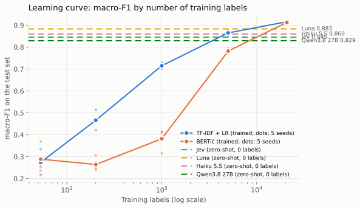

# Results

Generated by `report.py` from `results.db`. Test items: 5938 (main split), 5934 (brand split). Non-answers count as wrong.

## 1. Main test set

| method | n | errors | errors 95% CI | error rate | accuracy | macro-F1 | macro-F1 95% CI | non-answers | coverage at <=1% error | top-2 accuracy | ECE |
| --- | ---: | ---: | --- | --- | ---: | ---: | --- | ---: | --- | --- | ---: |
| TF-IDF + LR | 5938 | 197 | 170-224 | 3.32% | 0.9668 | 0.9156 | 0.898-0.930 | 0 | 89.7% | 0.9902 | 0.0212 |
| BERTić | 5938 | 209 | 182-236 | 3.52% | 0.9648 | 0.9126 | 0.895-0.927 | 0 | 91.5% | 0.987 | 0.0286 |
| Jev | 5938 | 367 | 332-404 | 6.18% | 0.9382 | 0.8452 | 0.827-0.861 | 0 | 71.9% | 0.9742 | 0.0163 |
| Luna | 5938 | 275 | 245-308 | 4.63% | 0.9537 | 0.8831 | 0.866-0.898 | 2 | 75.0% | 0.9808 | 0.0252 |
| Haiku 5.5 | 5938 | 358 | 323-394 | 6.03% | 0.9397 | 0.8597 | 0.842-0.876 | 0 | 52.8% | – | 0.0323 |
| Qwen3.8 27B | 5938 | 448 | 410-488 | 7.54% | 0.9246 | 0.8292 | 0.811-0.846 | 0 | 0.0% | – | 0.0507 |

## Pairwise comparison (main test set)

Exact McNemar test on the items where one method is right and the other wrong; Holm correction over all pairs. 95% CI: paired bootstrap of the error-count difference.

| A | B | errors A - B | 95% CI | only A right | only B right | McNemar p | Holm p | verdict |
| --- | --- | ---: | --- | ---: | ---: | ---: | ---: | --- |
| TF-IDF + LR | BERTić | -12 | -37 to 13 | 91 | 79 | 0.3989 | 0.7979 | not distinguishable |
| TF-IDF + LR | Jev | -170 | -208 to -135 | 257 | 87 | 0.0 | 0.0 | TF-IDF + LR better |
| TF-IDF + LR | Luna | -78 | -111 to -45 | 180 | 102 | 0.0 | 0.0 | TF-IDF + LR better |
| TF-IDF + LR | Haiku 5.5 | -161 | -199 to -124 | 264 | 103 | 0.0 | 0.0 | TF-IDF + LR better |
| TF-IDF + LR | Qwen3.8 27B | -251 | -291 to -211 | 339 | 88 | 0.0 | 0.0 | TF-IDF + LR better |
| BERTić | Jev | -158 | -195 to -122 | 252 | 94 | 0.0 | 0.0 | BERTić better |
| BERTić | Luna | -66 | -99 to -34 | 169 | 103 | 0.0001 | 0.0002 | BERTić better |
| BERTić | Haiku 5.5 | -149 | -188 to -111 | 266 | 117 | 0.0 | 0.0 | BERTić better |
| BERTić | Qwen3.8 27B | -239 | -278 to -200 | 325 | 86 | 0.0 | 0.0 | BERTić better |
| Jev | Luna | 92 | 63 to 122 | 66 | 158 | 0.0 | 0.0 | Luna better |
| Jev | Haiku 5.5 | 9 | -23 to 41 | 129 | 138 | 0.6245 | 0.7979 | not distinguishable |
| Jev | Qwen3.8 27B | -81 | -114 to -48 | 183 | 102 | 0.0 | 0.0 | Jev better |
| Luna | Haiku 5.5 | -83 | -116 to -51 | 183 | 100 | 0.0 | 0.0 | Luna better |
| Luna | Qwen3.8 27B | -173 | -208 to -138 | 255 | 82 | 0.0 | 0.0 | Luna better |
| Haiku 5.5 | Qwen3.8 27B | -90 | -126 to -53 | 220 | 130 | 0.0 | 0.0 | Haiku 5.5 better |

## Confidence thresholds (main test set)

| method | confidence >= | coverage | error among covered | routed to review |
| --- | ---: | --- | --- | --- |
| TF-IDF + LR | 0.5 | 98.1% | 2.58% | 1.9% |
| TF-IDF + LR | 0.7 | 94.7% | 1.56% | 5.3% |
| TF-IDF + LR | 0.9 | 86.4% | 0.80% | 13.6% |
| TF-IDF + LR | 0.95 | 77.9% | 0.54% | 22.1% |
| BERTić | 0.5 | 99.9% | 3.46% | 0.1% |
| BERTić | 0.7 | 99.1% | 3.08% | 0.9% |
| BERTić | 0.9 | 98.3% | 2.65% | 1.7% |
| BERTić | 0.95 | 97.2% | 2.29% | 2.8% |
| Jev | 0.5 | 97.7% | 5.10% | 2.3% |
| Jev | 0.7 | 92.9% | 3.52% | 7.1% |
| Jev | 0.9 | 84.6% | 1.95% | 15.4% |
| Jev | 0.95 | 80.6% | 1.55% | 19.4% |
| Luna | 0.5 | 97.7% | 3.62% | 2.3% |
| Luna | 0.7 | 93.0% | 2.46% | 7.0% |
| Luna | 0.9 | 84.0% | 1.28% | 16.0% |
| Luna | 0.95 | 75.0% | 0.97% | 25.0% |
| Haiku 5.5 | 0.5 | 99.7% | 5.83% | 0.3% |
| Haiku 5.5 | 0.7 | 96.6% | 4.69% | 3.4% |
| Haiku 5.5 | 0.9 | 87.0% | 2.48% | 13.0% |
| Haiku 5.5 | 0.95 | 52.8% | 0.86% | 47.2% |
| Qwen3.8 27B | 0.5 | 99.8% | 7.43% | 0.2% |
| Qwen3.8 27B | 0.7 | 99.3% | 7.16% | 0.7% |
| Qwen3.8 27B | 0.9 | 98.8% | 6.84% | 1.2% |
| Qwen3.8 27B | 0.95 | 98.0% | 6.48% | 2.0% |

## Per class (main test set)

| method | category | support | correct | precision | recall | F1 |
| --- | --- | ---: | ---: | ---: | ---: | ---: |
| TF-IDF + LR | food | 2841 | 2823 | 0.978 | 0.994 | 0.986 |
| TF-IDF + LR | drinks | 513 | 488 | 0.968 | 0.951 | 0.96 |
| TF-IDF + LR | alcohol | 616 | 606 | 0.992 | 0.984 | 0.988 |
| TF-IDF + LR | cosmetics | 888 | 860 | 0.962 | 0.968 | 0.965 |
| TF-IDF + LR | toiletries | 108 | 81 | 0.88 | 0.75 | 0.81 |
| TF-IDF + LR | cleaning | 411 | 396 | 0.966 | 0.964 | 0.965 |
| TF-IDF + LR | household | 254 | 225 | 0.9 | 0.886 | 0.893 |
| TF-IDF + LR | baby | 148 | 119 | 0.826 | 0.804 | 0.815 |
| TF-IDF + LR | health | 29 | 22 | 0.88 | 0.759 | 0.815 |
| TF-IDF + LR | pets | 130 | 121 | 0.992 | 0.931 | 0.96 |
| BERTić | food | 2841 | 2798 | 0.986 | 0.985 | 0.985 |
| BERTić | drinks | 513 | 489 | 0.95 | 0.953 | 0.951 |
| BERTić | alcohol | 616 | 608 | 0.981 | 0.987 | 0.984 |
| BERTić | cosmetics | 888 | 855 | 0.962 | 0.963 | 0.962 |
| BERTić | toiletries | 108 | 87 | 0.784 | 0.806 | 0.795 |
| BERTić | cleaning | 411 | 393 | 0.959 | 0.956 | 0.957 |
| BERTić | household | 254 | 222 | 0.917 | 0.874 | 0.895 |
| BERTić | baby | 148 | 128 | 0.848 | 0.865 | 0.856 |
| BERTić | health | 29 | 24 | 0.727 | 0.828 | 0.774 |
| BERTić | pets | 130 | 125 | 0.969 | 0.962 | 0.965 |
| Jev | food | 2841 | 2739 | 0.973 | 0.964 | 0.969 |
| Jev | drinks | 513 | 488 | 0.899 | 0.951 | 0.924 |
| Jev | alcohol | 616 | 603 | 0.976 | 0.979 | 0.977 |
| Jev | cosmetics | 888 | 833 | 0.97 | 0.938 | 0.954 |
| Jev | toiletries | 108 | 91 | 0.734 | 0.843 | 0.784 |
| Jev | cleaning | 411 | 364 | 0.926 | 0.886 | 0.905 |
| Jev | household | 254 | 219 | 0.805 | 0.862 | 0.833 |
| Jev | baby | 148 | 103 | 0.88 | 0.696 | 0.777 |
| Jev | health | 29 | 27 | 0.3 | 0.931 | 0.454 |
| Jev | pets | 130 | 104 | 0.963 | 0.8 | 0.874 |
| Luna | food | 2841 | 2766 | 0.98 | 0.974 | 0.977 |
| Luna | drinks | 513 | 476 | 0.939 | 0.928 | 0.933 |
| Luna | alcohol | 616 | 607 | 0.979 | 0.985 | 0.982 |
| Luna | cosmetics | 888 | 859 | 0.975 | 0.967 | 0.971 |
| Luna | toiletries | 108 | 94 | 0.817 | 0.87 | 0.843 |
| Luna | cleaning | 411 | 372 | 0.971 | 0.905 | 0.937 |
| Luna | household | 254 | 229 | 0.763 | 0.902 | 0.827 |
| Luna | baby | 148 | 118 | 0.952 | 0.797 | 0.868 |
| Luna | health | 29 | 26 | 0.413 | 0.897 | 0.565 |
| Luna | pets | 130 | 116 | 0.967 | 0.892 | 0.928 |
| Haiku 5.5 | food | 2841 | 2734 | 0.972 | 0.962 | 0.967 |
| Haiku 5.5 | drinks | 513 | 501 | 0.855 | 0.977 | 0.912 |
| Haiku 5.5 | alcohol | 616 | 597 | 0.993 | 0.969 | 0.981 |
| Haiku 5.5 | cosmetics | 888 | 839 | 0.988 | 0.945 | 0.966 |
| Haiku 5.5 | toiletries | 108 | 87 | 0.87 | 0.806 | 0.837 |
| Haiku 5.5 | cleaning | 411 | 377 | 0.887 | 0.917 | 0.902 |
| Haiku 5.5 | household | 254 | 207 | 0.79 | 0.815 | 0.802 |
| Haiku 5.5 | baby | 148 | 97 | 0.795 | 0.655 | 0.719 |
| Haiku 5.5 | health | 29 | 27 | 0.443 | 0.931 | 0.6 |
| Haiku 5.5 | pets | 130 | 114 | 0.95 | 0.877 | 0.912 |
| Qwen3.8 27B | food | 2841 | 2691 | 0.974 | 0.947 | 0.961 |
| Qwen3.8 27B | drinks | 513 | 482 | 0.861 | 0.94 | 0.898 |
| Qwen3.8 27B | alcohol | 616 | 597 | 0.98 | 0.969 | 0.975 |
| Qwen3.8 27B | cosmetics | 888 | 844 | 0.94 | 0.95 | 0.945 |
| Qwen3.8 27B | toiletries | 108 | 92 | 0.713 | 0.852 | 0.776 |
| Qwen3.8 27B | cleaning | 411 | 364 | 0.869 | 0.886 | 0.877 |
| Qwen3.8 27B | household | 254 | 187 | 0.742 | 0.736 | 0.739 |
| Qwen3.8 27B | baby | 148 | 105 | 0.854 | 0.709 | 0.775 |
| Qwen3.8 27B | health | 29 | 26 | 0.342 | 0.897 | 0.495 |
| Qwen3.8 27B | pets | 130 | 102 | 0.927 | 0.785 | 0.85 |

## Agreement (main test set)

Items where two methods agree with each other and not with the label are often label errors (section 8.3).

| A | B | agreement | agreed, label differs | disagreed | label = A | label = B | label = neither |
| --- | --- | --- | ---: | ---: | ---: | ---: | ---: |
| TF-IDF + LR | BERTić | 96.9% | 103 | 185 | 91 | 79 | 15 |
| TF-IDF + LR | Jev | 93.7% | 81 | 373 | 257 | 87 | 29 |
| TF-IDF + LR | Luna | 94.9% | 74 | 303 | 180 | 102 | 21 |
| TF-IDF + LR | Haiku 5.5 | 93.5% | 73 | 388 | 264 | 103 | 21 |
| TF-IDF + LR | Qwen3.8 27B | 92.3% | 77 | 459 | 339 | 88 | 32 |
| BERTić | Jev | 93.7% | 89 | 372 | 252 | 94 | 26 |
| BERTić | Luna | 94.9% | 77 | 301 | 169 | 103 | 29 |
| BERTić | Haiku 5.5 | 93.2% | 69 | 406 | 266 | 117 | 23 |
| BERTić | Qwen3.8 27B | 92.3% | 76 | 458 | 325 | 86 | 47 |
| Jev | Luna | 95.6% | 174 | 259 | 66 | 158 | 35 |
| Jev | Haiku 5.5 | 94.8% | 188 | 308 | 129 | 138 | 41 |
| Jev | Qwen3.8 27B | 94.2% | 203 | 347 | 183 | 102 | 62 |
| Luna | Haiku 5.5 | 94.7% | 146 | 312 | 183 | 100 | 29 |
| Luna | Qwen3.8 27B | 93.6% | 150 | 380 | 255 | 82 | 43 |
| Haiku 5.5 | Qwen3.8 27B | 93.3% | 182 | 396 | 220 | 130 | 46 |

## 2. Learning curve

| method | size | train items | seeds | accuracy mean | accuracy min | accuracy max | macro-F1 mean | macro-F1 min | macro-F1 max |
| --- | --- | ---: | ---: | ---: | ---: | ---: | ---: | ---: | ---: |
| TF-IDF + LR | 50 | 53 | 5 | 0.6115 | 0.5729 | 0.6295 | 0.2741 | 0.2176 | 0.3338 |
| TF-IDF + LR | 200 | 202 | 5 | 0.7486 | 0.7378 | 0.7612 | 0.4663 | 0.4207 | 0.5143 |
| TF-IDF + LR | 1000 | 1001 | 5 | 0.8818 | 0.8754 | 0.885 | 0.715 | 0.7017 | 0.728 |
| TF-IDF + LR | 5000 | 5000 | 5 | 0.9431 | 0.9407 | 0.9459 | 0.8648 | 0.8507 | 0.876 |
| TF-IDF + LR | all | 20777 | 1 | 0.9668 | 0.9668 | 0.9668 | 0.9156 | 0.9156 | 0.9156 |
| BERTić | 50 | 53 | 5 | 0.6801 | 0.6588 | 0.7024 | 0.2886 | 0.2364 | 0.3689 |
| BERTić | 200 | 202 | 5 | 0.7075 | 0.6948 | 0.7221 | 0.2643 | 0.2394 | 0.3059 |
| BERTić | 1000 | 1001 | 5 | 0.7796 | 0.7415 | 0.7998 | 0.3819 | 0.3158 | 0.414 |
| BERTić | 5000 | 5000 | 5 | 0.9388 | 0.9352 | 0.9419 | 0.7816 | 0.7709 | 0.7934 |
| BERTić | all | 20777 | 1 | 0.9648 | 0.9648 | 0.9648 | 0.9126 | 0.9126 | 0.9126 |

## 3. Unseen brands: brand split

Trained methods are trained on `split_brand = train`; no test brand occurs in training.

| method | n | errors | errors 95% CI | error rate | accuracy | macro-F1 | macro-F1 95% CI | non-answers | coverage at <=1% error | top-2 accuracy | ECE |
| --- | ---: | ---: | --- | --- | ---: | ---: | --- | ---: | --- | --- | ---: |
| TF-IDF + LR | 5934 | 431 | 393-470 | 7.26% | 0.9274 | 0.8146 | 0.789-0.839 | 0 | 70.8% | 0.9754 | 0.0115 |
| BERTić | 5934 | 472 | 431-513 | 7.95% | 0.9205 | 0.8015 | 0.780-0.822 | 0 | 51.5% | 0.9562 | 0.0543 |
| Jev | 5934 | 337 | 302-372 | 5.68% | 0.9432 | 0.8461 | 0.829-0.862 | 0 | 67.2% | 0.9816 | 0.0206 |
| Luna | 5934 | 282 | 251-315 | 4.75% | 0.9525 | 0.8633 | 0.847-0.879 | 1 | 0.0% | 0.985 | 0.0212 |
| Haiku 5.5 | 5934 | 372 | 336-409 | 6.27% | 0.9373 | 0.8381 | 0.820-0.855 | 0 | 44.2% | – | 0.0321 |
| Qwen3.8 27B | 5934 | 419 | 381-458 | 7.06% | 0.9294 | 0.8178 | 0.799-0.835 | 0 | 0.0% | – | 0.0463 |

## Pairwise comparison (brand split)

| A | B | errors A - B | 95% CI | only A right | only B right | McNemar p | Holm p | verdict |
| --- | --- | ---: | --- | ---: | ---: | ---: | ---: | --- |
| TF-IDF + LR | BERTić | -41 | -76 to -5 | 185 | 144 | 0.0273 | 0.1055 | not distinguishable |
| TF-IDF + LR | Jev | 94 | 50 to 138 | 197 | 291 | 0.0 | 0.0002 | Jev better |
| TF-IDF + LR | Luna | 149 | 106 to 191 | 162 | 311 | 0.0 | 0.0 | Luna better |
| TF-IDF + LR | Haiku 5.5 | 59 | 12 to 106 | 257 | 316 | 0.0153 | 0.0766 | not distinguishable |
| TF-IDF + LR | Qwen3.8 27B | 12 | -35 to 58 | 278 | 290 | 0.6444 | 0.6444 | not distinguishable |
| BERTić | Jev | 135 | 92 to 179 | 171 | 306 | 0.0 | 0.0 | Jev better |
| BERTić | Luna | 190 | 148 to 233 | 140 | 330 | 0.0 | 0.0 | Luna better |
| BERTić | Haiku 5.5 | 100 | 53 to 147 | 242 | 342 | 0.0 | 0.0003 | Haiku 5.5 better |
| BERTić | Qwen3.8 27B | 53 | 7 to 98 | 248 | 301 | 0.0264 | 0.1055 | not distinguishable |
| Jev | Luna | 55 | 25 to 84 | 84 | 139 | 0.0003 | 0.002 | Luna better |
| Jev | Haiku 5.5 | -35 | -69 to -2 | 163 | 128 | 0.0461 | 0.1055 | not distinguishable |
| Jev | Qwen3.8 27B | -82 | -116 to -49 | 189 | 107 | 0.0 | 0.0 | Jev better |
| Luna | Haiku 5.5 | -90 | -126 to -55 | 209 | 119 | 0.0 | 0.0 | Luna better |
| Luna | Qwen3.8 27B | -137 | -172 to -102 | 228 | 91 | 0.0 | 0.0 | Luna better |
| Haiku 5.5 | Qwen3.8 27B | -47 | -81 to -13 | 176 | 129 | 0.0083 | 0.05 | Haiku 5.5 better |

## Unseen-brand slice of the main test set (343 items)

| method | n | errors | errors 95% CI | error rate | accuracy | macro-F1 | macro-F1 95% CI | non-answers | coverage at <=1% error | top-2 accuracy | ECE |
| --- | ---: | ---: | --- | --- | ---: | ---: | --- | ---: | --- | --- | ---: |
| TF-IDF + LR | 343 | 25 | 16-35 | 7.29% | 0.9271 | 0.7922 | 0.641-0.873 | 0 | 34.4% | 0.9796 | 0.0216 |
| BERTić | 343 | 17 | 10-25 | 4.96% | 0.9504 | 0.8232 | 0.692-0.902 | 0 | 84.5% | 0.965 | 0.044 |
| Jev | 343 | 20 | 12-29 | 5.83% | 0.9417 | 0.7857 | 0.648-0.872 | 0 | 68.8% | 0.9767 | 0.033 |
| Luna | 343 | 21 | 13-30 | 6.12% | 0.9388 | 0.7942 | 0.638-0.877 | 0 | 37.0% | 0.9767 | 0.026 |
| Haiku 5.5 | 343 | 22 | 14-31 | 6.41% | 0.9359 | 0.7672 | 0.648-0.851 | 0 | 73.8% | – | 0.0389 |
| Qwen3.8 27B | 343 | 25 | 16-35 | 7.29% | 0.9271 | 0.7348 | 0.600-0.822 | 0 | 39.1% | – | 0.0519 |

## 5. Hard set (515 items)

TF-IDF errors on the main test set plus the unseen-brand items. TF-IDF scores low here by construction.

| method | n | errors | errors 95% CI | error rate | accuracy | macro-F1 | macro-F1 95% CI | non-answers | coverage at <=1% error | top-2 accuracy | ECE |
| --- | ---: | ---: | --- | --- | ---: | ---: | --- | ---: | --- | --- | ---: |
| TF-IDF + LR | 515 | 197 | 176-219 | 38.25% | 0.6175 | 0.3924 | 0.331-0.445 | 0 | 5.0% | 0.8874 | 0.224 |
| BERTić | 515 | 122 | 104-141 | 23.69% | 0.7631 | 0.6357 | 0.575-0.685 | 0 | 5.8% | 0.9126 | 0.2151 |
| Jev | 515 | 117 | 99-136 | 22.72% | 0.7728 | 0.6297 | 0.572-0.680 | 0 | 0.0% | 0.8854 | 0.1329 |
| Luna | 515 | 105 | 87-123 | 20.39% | 0.7961 | 0.6721 | 0.612-0.723 | 2 | 0.0% | 0.8874 | 0.0982 |
| Haiku 5.5 | 515 | 107 | 90-125 | 20.78% | 0.7922 | 0.6712 | 0.613-0.719 | 0 | 10.9% | – | 0.103 |
| Qwen3.8 27B | 515 | 123 | 104-142 | 23.88% | 0.7612 | 0.6062 | 0.544-0.658 | 0 | 0.0% | – | 0.203 |

## Speed

Batch size 1, warm. API latency is from first-attempt successes of the main run and includes the network (client in the EU). Throughput: API at the stated concurrency, local methods with a large batch.

| method | device | latency p50 / p90 / p99 (ms) | throughput (items/s) | notes |
| --- | --- | --- | ---: | --- |
| Jev | API | 166 / 196 / 259 | 93.4 | concurrency 16, retries {} |
| Luna | API | 246 / 369 / 522 | 64.4 | concurrency 16, retries {} |
| Haiku 5.5 | API | 1065 / 1663 / 3827 | 13.1 | concurrency 16, retries {'retry:502': 1} |
| Qwen3.8 27B | API | 700 / 1000 / 4755 | 18.2 | concurrency 16, retries {'retry:429': 2} |
| TF-IDF + LR | CPU | 0.30 / 0.35 / 0.43 | 41461.0 | bulk batch 5938 |
| BERTić | GPU | 2.98 / 3.23 / 3.77 | 1159.0 | bulk batch 512 |
| BERTić | CPU | 17.50 / 19.13 / 21.12 | 110.0 | bulk batch 512 |

## OpenRouter share of the latency (Haiku, Qwen)

From `GET /api/v1/generation` for a sample of main-run requests. Client latency minus the provider's generation time estimates what OpenRouter and the network add.

| method | n | client latency p50 (ms) | provider generation time p50 (ms) | time to first token p50 (ms) | client - generation time p50 / p90 (ms) |
| --- | ---: | ---: | ---: | ---: | --- |
| Haiku 5.5 | 199 | 1052 | 969 | 888 | 38 / 91 |
| Qwen3.8 27B | 197 | 690 | 644 | 508 | 41 / 82 |

## Cost

Cost per 1,000 items: mean over the main test items. TF-IDF and BERTić: no dollar figure, see Resources.

| method | input tokens / item | output tokens / item | cost per 1,000 items (USD) | cost source | tuning spend (USD) | tuning variants |
| --- | ---: | ---: | ---: | --- | ---: | ---: |
| Jev | 681.1 | 98.9 | 0.0286 | tokens × list price | 0.0429 | 3 |
| Luna | 402.3 | 0.0 | 0.0402 | tokens × list price | 0.0602 | 3 |
| Haiku 5.5 | 885.8 | 18.1 | 0.0976 | usage.cost | 0.1461 | 3 |
| Qwen3.8 27B | 364.7 | 20.7 | 0.0424 | usage.cost | 0.0634 | 3 |

## Resources (TF-IDF, BERTić)

Hardware of the machine that made this report (normally the one that ran the timings): 13th Gen Intel(R) Core(TM) i5-13500 (20 threads), 126 GiB RAM, NVIDIA GeForce RTX 3060 12288 MiB. peak_rss_mb is the process peak so far.

| method | variant | phase | device | batch_size | n_items | wall_s | peak_rss_mb | peak_vram_alloc_mb | peak_vram_reserved_mb | peak_vram_process_mb |
| --- | --- | --- | --- | ---: | ---: | ---: | ---: | ---: | ---: | ---: |
| TF-IDF + LR | main | train | cpu | – | 20777 | 17.5 | 349.5 | – | – | – |
| TF-IDF + LR | main | infer | cpu | 1 | 5938 | 1.8 | 349.5 | – | – | – |
| TF-IDF + LR | main | infer | cpu | 5938 | 5938 | 0.1 | 349.5 | – | – | – |
| TF-IDF + LR | brand | train | cpu | – | 20789 | 16.3 | 351.8 | – | – | – |
| BERTić | main | train | cuda | 32 | 20777 | 574.5 | 2067.8 | 1969.3 | 2254.0 | 2396.0 |
| BERTić | brand | train | cuda | 32 | 20789 | 561.7 | 2361.8 | 1978.3 | 2296.0 | 2438.0 |
| BERTić | main | infer | cuda | 512 | 5938 | 5.1 | 1415.1 | 944.2 | 1894.0 | 2026.0 |
| BERTić | main | infer | cuda | 1 | 5938 | 18.1 | 1415.1 | 432.9 | 1894.0 | 2026.0 |
| BERTić | main | infer | cpu | 512 | 5938 | 53.6 | 2521.3 | – | – | – |
| BERTić | main | infer | cpu | 1 | 5938 | 102.2 | 2521.3 | – | – | – |

## Prompt tuning (500 tune items, correct answers)

| variant | Jev | Luna | Haiku 5.5 | Qwen3.8 27B |
| --- | ---: | ---: | ---: | ---: |
| tune-v1 | 466 | 481 | 465 | 451 |
| tune-v2 | 468 | 479 | 472 | 464 |
| tune-v3 | 467 | 482 | 471 | 460 |
